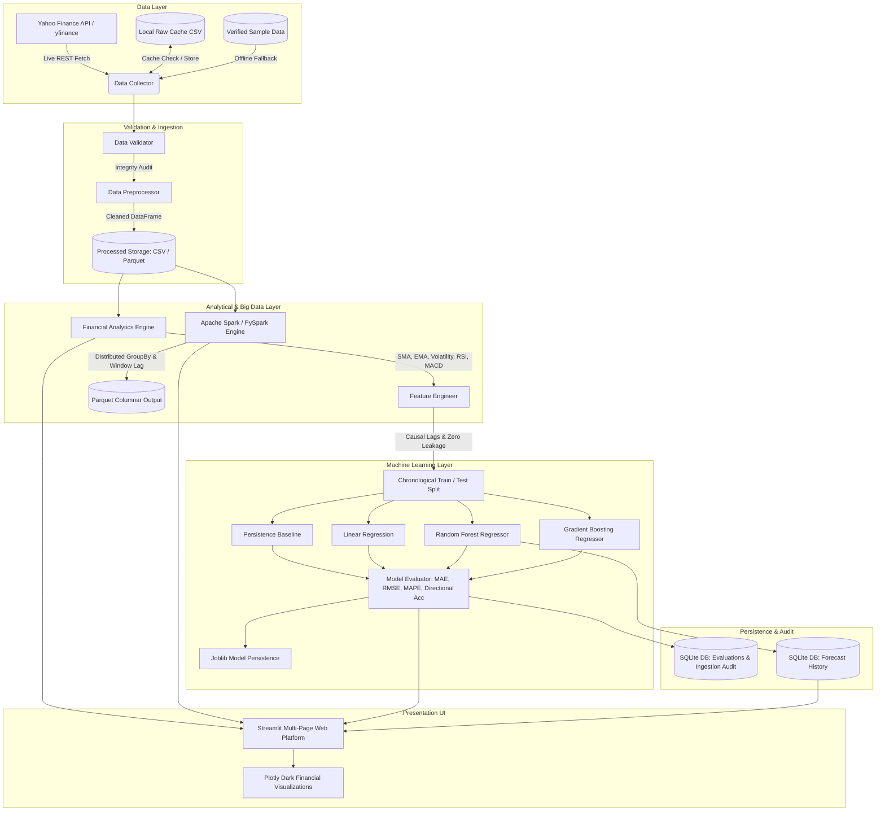

# System Architecture & Design Specification

## Project Title
**Stock Market Data Analysis and Prediction Using Big Data Analytics and Machine Learning**

---

## 1. Architectural Overview

The application follows a clean, decoupled, layered architectural design adhering to separation of concerns. The system bridges external financial data sources, local and distributed data processing engines, machine learning pipelines, and interactive presentation interfaces.

---

## 2. Layered Component Descriptions

### 2.1 Ingestion & Collection Layer (`src/data_collection.py`)
- **Primary Source:** `yfinance` unofficial Python wrapper for Yahoo Finance historical data.
- **Resilience:** Implements a multi-tiered failover hierarchy:
  1. *Local Raw Cache:* Inspects `data/raw/` to avoid repeated external network requests.
  2. *Live yfinance Network Fetch:* Fetches daily OHLCV series for Indian NSE tickers (`.NS` suffix).
  3. *Verified Sample Fallback:* In the event of network disruption, rate-limits, or offline environments, transparently loads pre-generated verified fixtures from `data/sample/`.
  4. *Audit Logging:* Records each attempt in SQLite (`data_ingestion_log`).

### 2.2 Validation & Cleaning Layer (`src/data_validation.py`, `src/preprocessing.py`)
- Standardizes column casing to snake_case (`date, open, high, low, close, volume`).
- Enforces financial price invariants:
  - $\text{High} \ge \text{Low}$
  - $\text{Open} > 0, \text{Close} > 0, \text{High} > 0, \text{Low} > 0$
  - $\text{Volume} \ge 0$
- Drops duplicate date entries while preserving chronological sorting.
- Strips timezones to normalize to daily trading sessions.

### 2.3 Big Data Analytics Layer (`src/spark_processor.py`)
- Utilizes **Apache Spark (PySpark)** for scalable DataFrame operations:
  - Explicit schema validation via `StructType` and `StructField`.
  - Window partitions via `Window.partitionBy("symbol").orderBy("date_parsed")`.
  - Inter-session lags and rolling moving averages across multi-symbol portfolios.
  - Columnar export to **Apache Parquet** format.
- Implements a transparent fallback to vectorised **Pandas** operations when Spark JVM runtime is unavailable.

### 2.4 Machine Learning & Feature Engineering Layer (`src/feature_engineering.py`, `src/prediction_model.py`)
- Constructs 20 autoregressive and technical indicator features strictly up to trading session $t$.
- Defines target variable as $y_t = \text{Close}_{t+1}$.
- Enforces chronological 80% train / 20% test splitting.
- Prevents data leakage by fitting normalizers (`StandardScaler`) exclusively on the training split.
- Evaluates against an empirical Persistence Baseline.

### 2.5 Storage & Database Layer (`src/database.py`, `src/storage.py`)
- **SQLite Database (`database/stock_analytics.db`):** Stores structured audit logs, evaluation metrics, and forecast predictions.
- **Apache Parquet:** Stores analytical datasets in compressed, partitioned columnar structures.
- **Joblib:** Serializes trained machine learning pipelines with schema and feature validation.

### 2.6 Presentation Layer (`app.py`, `pages/`, `src/visualization.py`)
- Interactive **Streamlit** multi-page application.
- Dark institutional theme inspired by institutional Bloomberg and TradingView terminals.
- **Plotly** responsive SVG/WebGL charts for Candlesticks, Moving Averages, RSI, MACD, and Residual analysis.
