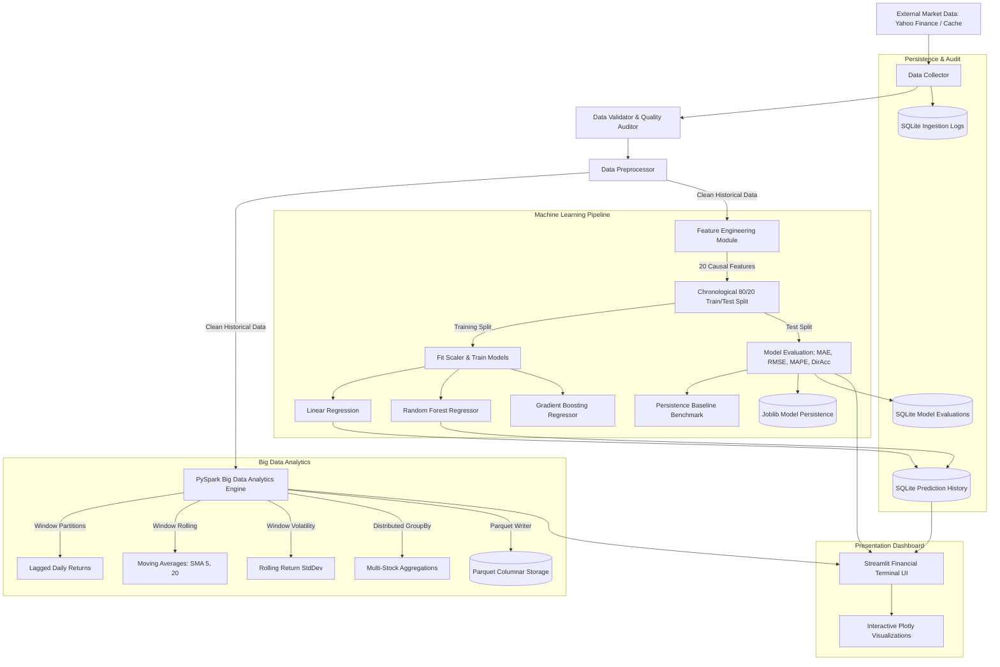

# Academic Major Project Report

## Project Title
**Stock Market Data Analysis and Prediction Using Big Data Analytics and Machine Learning**

---

## 1. Abstract
The rapid digitization of global financial markets has resulted in the continuous generation of massive volumes of high-velocity market data. Extracting meaningful quantitative signals and forecasting price trajectories requires scalable distributed big data processing and statistically rigorous machine learning. This project presents an end-to-end financial analytics platform that integrates **Apache Spark (PySpark)** for distributed data transformations, **Scikit-Learn** for autoregressive predictive modeling, **SQLite** for relational audit storage, **Apache Parquet** for compressed columnar persistence, and **Streamlit** alongside **Plotly** for responsive, institutional-grade data visualization.

Crucially, the system strictly enforces temporal causality and prevents future-data leakage through causal feature lagging and chronological 80/20 train/test splitting. Predictive models (Linear Regression, Random Forest Regressor, and Gradient Boosting) are systematically benchmarked against a naive persistence baseline across Mean Absolute Error (MAE), Root Mean Squared Error (RMSE), Mean Absolute Percentage Error (MAPE), and Directional Accuracy.

---

## 2. Introduction & Problem Statement

### 2.1 Background
Financial equities represent highly complex, non-stationary dynamical systems influenced by macroeconomic conditions, investor sentiment, and algorithmic high-frequency trading. Retail investors and academic researchers face challenges in analyzing multi-asset portfolios due to data fragmentation, computationally intensive indicators, and naive prediction methodologies that suffer from lookahead bias.

### 2.2 Existing System Limitations
1. **Pervasive Data Leakage:** Standard tutorial projects frequently randomize train/test splits via random cross-validation, allowing models to cheat by learning future observations to predict past prices.
2. **Lack of Empirical Baselines:** Model accuracy is often reported without benchmarking against a persistence baseline ($\hat{y}_{t+1} = y_t$), leading to deceptive performance claims in random-walk markets.
3. **Single-Node Scalability Bottlenecks:** Traditional Pandas workflows load entire datasets into single-node RAM, which fails when aggregating multi-decade tick datasets across hundreds of securities.
4. **Poor Resilience to API Outages:** Most prototype applications crash upon network timeout or API rate-limiting.

### 2.3 Proposed System Highlights
- **Resilient Multi-Tier Collection:** Integrates live `yfinance` queries with local raw caching and verified offline sample fixtures.
- **Distributed Big Data Engine:** True Apache Spark DataFrame transformations utilizing explicit `StructType` schemas, window partitions (`Window.partitionBy().orderBy()`), and Parquet export.
- **Leakage-Free Feature Engineering:** 20 causal lag-based features constructed strictly on or before session $t$.
- **Transparent Benchmarking:** Real-time empirical comparison between Pandas in-memory and PySpark execution times with honest documentation of JVM fixed overheads.

---

## 3. System Architecture & Data Flow

---

## 4. Module Descriptions

| Module | File | Core Purpose |
| :--- | :--- | :--- |
| **Configuration** | `src/config.py` | Centralizes system paths, supported NSE ticker registry, hyperparameters, and UI themes. |
| **Data Collection** | `src/data_collection.py` | Manages live `yfinance` calls, caching, and fallback to sample fixtures. |
| **Data Validation** | `src/data_validation.py` | Verifies schemas, checks price invariants ($H \ge L, O > 0, C > 0$), and audits duplicates. |
| **Preprocessing** | `src/preprocessing.py` | Deduplicates dates, normalizes discrete daily timestamps, and exports CSV/Parquet. |
| **Financial Analytics** | `src/financial_analytics.py` | Computes SMA, EMA, Bollinger Bands, RSI 14, MACD, and rolling annualized volatility. |
| **Big Data Engine** | `src/spark_processor.py` | PySpark DataFrame pipeline, window functions, and empirical Pandas benchmark. |
| **Feature Engineering**| `src/feature_engineering.py` | Constructs 20 causal lag features with zero lookahead bias; sets target as $C_{t+1}$. |
| **Prediction Models** | `src/prediction_model.py` | Implements Linear Regression, Random Forest, Gradient Boosting, and Persistence baseline. |
| **Model Evaluation** | `src/model_evaluation.py` | Computes out-of-sample MAE, RMSE, MAPE, and Directional Accuracy. |
| **Database Manager** | `src/database.py` | SQLite manager for audit trails, evaluation records, and forecast histories. |
| **Storage Manager** | `src/storage.py` | Catalogs raw, processed, sample, and serialized model files. |
| **Visualizations** | `src/visualization.py` | Modular Plotly dark institutional financial charts. |

---

## 5. Experimental Results Section (Pending Run Verification)

*Note: In accordance with academic honesty, experimental metrics vary based on the specific historical evaluation window and ticker selected. Results below will be populated after executing model training on the target environment.*

| Model | MAE (₹) | RMSE (₹) | MAPE (%) | Directional Accuracy (%) | Status |
| :--- | :--- | :--- | :--- | :--- | :--- |
| **Persistence Baseline** | *[Dynamic]* | *[Dynamic]* | *[Dynamic]* | *[Dynamic]* | Naive Benchmark |
| **Linear Regression** | *[Dynamic]* | *[Dynamic]* | *[Dynamic]* | *[Dynamic]* | Parametric Baseline |
| **Random Forest Regressor** | *[Dynamic]* | *[Dynamic]* | *[Dynamic]* | *[Dynamic]* | Non-Linear Ensemble |
| **Gradient Boosting** | *[Dynamic]* | *[Dynamic]* | *[Dynamic]* | *[Dynamic]* | Gradient Tree Ensemble |

---

## 6. Testing Methodology
The system incorporates an automated test suite executed via **Pytest**:
1. **Schema & Validation Tests:** Verifies detection of missing columns, corrupted dates, and price invariant violations.
2. **Preprocessing Tests:** Verifies deduplication and chronological ordering.
3. **Indicator Accuracy:** Checks mathematical precision of daily returns, SMA, and Bollinger Bands against analytical formulas.
4. **Leakage Verification:** Explicitly proves that feature matrices at row $t$ do not change when future prices at $t+1$ are artificially altered.
5. **Model & Metric Tests:** Validates chronological splitting bounds and evaluation metric calculations.
6. **Spark & Fallback Tests:** Verifies PySpark DataFrame transformations and graceful fallback to Pandas.

---

## 7. Limitations & Future Scope

### 7.1 Limitations
- **Efficient Market Hypothesis:** Daily historical price and volume series cannot predict unanticipated exogenous shocks (earnings surprises, geopolitical conflicts, regulatory decisions).
- **Daily Aggregation:** Does not capture intraday high-frequency microstructure dynamics or limit order book liquidity.

### 7.2 Future Scope
- **Alternative Data Integration:** Integrating real-time financial news sentiment extraction via FinBERT NLP models.
- **Deep Learning Sequence Architectures:** Implementing LSTM and Temporal Fusion Transformers for multi-horizon forecasting.
- **Streaming Pipeline:** Incorporating Apache Kafka for low-latency tick ingestion into Spark Structured Streaming.
- **Algorithmic Backtester:** Simulating backtested portfolio rebalancing with slippage and transaction cost modeling.

---

## 8. References
1. Apache Spark Documentation: https://spark.apache.org/docs/latest/
2. PySpark API Reference: https://spark.apache.org/docs/latest/api/python/
3. Scikit-Learn Ensemble Methods: https://scikit-learn.org/stable/modules/ensemble.html
4. Streamlit Documentation: https://docs.streamlit.io/
5. Plotly Python Open Source Graphing Library: https://plotly.com/python/
6. Yahoo Finance API Community Guide: https://pypi.org/project/yfinance/
